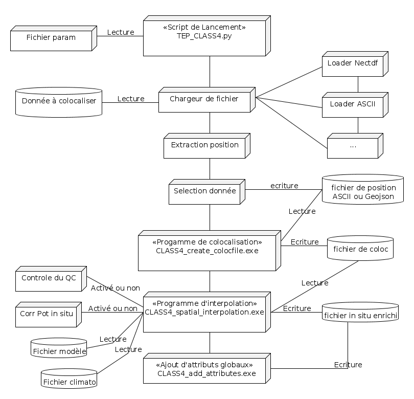

# TEP_CLASS4 

## Installation

### SVN 

svn co https://svn.mercator-ocean.fr/svnroot/mo/TEP/TEP_CLASS4/branches/V4/

### Gitlab 

git clone  https://gitlab.mercator-ocean.fr/mercator/qualif/TEP_CLASS4.git
### Compilation du code

Charger les modules suivants :
* module load intel
* module load netcdf
Linker avec la librairie MFT compilé avec la même version des modules 
#### Compilation de la lib mft 
```Recupération de la lib MFT sous SVN  :
https://svn.mercator-ocean.fr/svnroot/mo/LIB/LIB_MFT/branches/V3.7
cd src
make clean && make all
```
La compilation se fait avec le script Launcher.ksh qui a comme paramètre le systeme à compiler (lié  à une macro dans le répertoire macro). 

### Description du code 

La figure ci dessous décrit l'architecture du code



